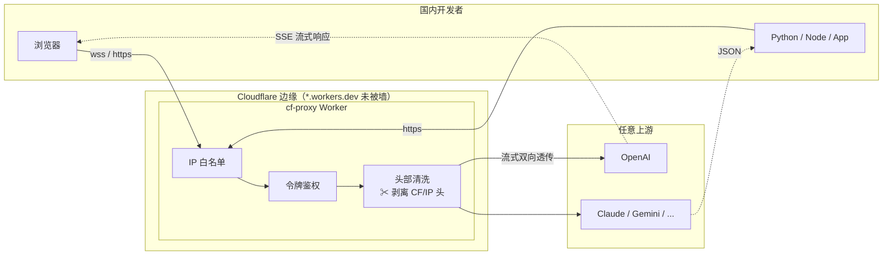

<div align="center">

# ⚡ cf-proxy

**跑在 Cloudflare 边缘的通用 API 反向代理**

[](https://workers.cloudflare.com/)
[](src/index.js)
[](src/index.js)
[](#特性)

*国内开发者访问海外 API 的零成本通道 —— 无需服务器，改配置、粘贴、上线。*

</div>

---

## 目录

- [特性](#特性)
- [架构](#架构)
- [快速开始](#快速开始)
- [用法](#用法)
- [配置](#配置)
- [安全模型](#安全模型)
- [本地开发](#本地开发)
- [FAQ](#faq)

## 特性

| | 特性 | 说明 |
|---|---|---|
| 🌐 | **HTTP/HTTPS 全方法透传** | GET/POST/PUT/PATCH/DELETE，body 流式转发 |
| ⚡ | **SSE 流式响应** | 大模型流式输出开箱即用 |
| 🔌 | **WebSocket 透传** | `ws://` / `wss://`，双向数据由边缘管道转发 |
| 🧼 | **请求头清洗** | 默认剥离浏览器指纹，统一 UA，上游看到的所有请求完全一致 |
| 🔐 | **三层访问控制** | IP 白名单 → 访问令牌 → 目标域名白名单，可独立叠加 |
| 📦 | **单文件零依赖** | 一个 `index.js` 约 15 KB，Dashboard 粘贴即部署 |
| 💰 | **免费额度** | Workers 免费版 10 万请求/天，个人使用绰绰有余 |

## 架构



## 快速开始

> 无需 clone、无需 npm install，浏览器里三步完成。

1. 打开 [Cloudflare Dashboard](https://dash.cloudflare.com) → **Workers & Pages** → **Create** → 起名部署，得到 `xxx.workers.dev` 地址
2. **Edit code** → 粘贴 [`src/index.js`](src/index.js) 全文 → **Deploy**
3. **Settings → Variables and Secrets** → 添加 Secret `PROXY_TOKEN`（你的访问令牌）

> CLI 党：`npm install && npm run deploy`（读取 `wrangler.toml`），两种方式等价。

## 用法

把目标 URL 拼在 `/proxy/` 后面即可：

```text
https://xxx.workers.dev/proxy/https://api.openai.com/v1/chat/completions
wss://xxx.workers.dev/proxy/wss://ws.example.com/path
```

### HTTP（OpenAI SDK）

```python
from openai import OpenAI

client = OpenAI(
    base_url="https://xxx.workers.dev/proxy/https://api.openai.com/v1",
    api_key="sk-你的真实key",                       # 业务 Key 直达上游
    default_headers={"x-proxy-token": "<TOKEN>"},  # 代理令牌独立传递
)
```

### WebSocket

```js
// 浏览器 / 通用客户端：token 走子协议伪装（代理校验后剔除，上游无感知）
const ws = new WebSocket("wss://xxx.workers.dev/proxy/wss://ws.example.com/path", "<TOKEN>");

// 代码客户端：token 也可走自定义头
const ws = new WebSocket(url, { headers: { "x-proxy-token": "<TOKEN>" } });
```

> 刻意不支持 `?token=` URL 参数 —— token 会落日志。WS 鉴权基于 `Sec-WebSocket-Protocol` 伪装，代理会回显选中的子协议，严格客户端（ws 库、Postman）全兼容。

## 配置

全部配置集中在 [`src/index.js`](src/index.js) 顶部的 `CONFIG`，改完重新粘贴即可；Dashboard 环境变量/Secret 同名时优先级更高。

| 配置项 | 默认值 | 说明 |
|---|---|---|
| `PROXY_TOKEN` | `""` | 访问令牌，留空不鉴权。生产环境建议用 Secret |
| `ALLOWED_HOSTS` | `"*"` | 目标域名限制；`"a.com,b.com"` 仅放行列表 |
| `CORS_ALLOW_ORIGIN` | `"*"` | CORS 来源 |
| `IP_WHITELIST` | `""` | 客户端 IP 白名单；支持精确 IP 与 IPv4 CIDR，如 `"1.2.3.4,10.0.0.0/8"` |
| `HEADER_MODE` | `"clean"` | `"clean"` 清洗浏览器指纹 / `"passthrough"` 原样透传 |
| `DEFAULT_USER_AGENT` | Chrome UA | clean 模式下所有请求的统一 UA |

## 安全模型

| 防线 | 层级 | 防什么 | 配置 |
|---|---|---|---|
| IP 白名单 | 网络层 | 未知来源接入 | `IP_WHITELIST`，基于 `CF-Connecting-IP`（边缘写入，不可伪造），fail closed |
| 访问令牌 | 身份层 | 蹭流量、盗用代理 | `PROXY_TOKEN`，HTTP 走头，WS 走子协议伪装 |
| 域名限制 | 目标层 | 被当作开放代理滥用 | `ALLOWED_HOSTS` |
| 头部清洗 | 隐私层 | 浏览器指纹泄漏 | `HEADER_MODE` |

> **边界**：CF 会强制注入 `Cf-Worker`、`Cdn-Loop` 等头，出口 IP 属于 Cloudflare 段——"使用了 Cloudflare"这件事无法隐藏。本代理清洗的是浏览器指纹（防 API 风控关联），不提供隐身能力。

## 本地开发

```bash
npm install
npm run dev                                   # http://127.0.0.1:8792
node test/ws-echo-server.mjs                  # 起 WS echo 服务器
node test/ws-client-test.mjs <代理地址> <目标ws url> <token>   # WS 回归测试
```

## FAQ

<details>
<summary><b>为什么连上了但上游没有回显？</b></summary>
部分公共 echo 服务（如 echo.websocket.org）已不再回显消息，仅发送欢迎语后断开。请使用 <code>wss://ws.postman-echo.com/raw</code> 作为测试基准。
</details>

<details>
<summary><b>请求计数包含被拒绝的请求吗？</b></summary>
包含。到达 Worker 的每个请求（含 401/403）都计入免费额度。令牌能挡住"替别人跑流量"，防"刷次数"需在 CF 控制台配置 WAF 速率限制规则（免费版含 1 条）。
</details>

<details>
<summary><b>Postman 里连不上？</b></summary>
WebSocket 请求的 URL 必须以 <code>wss://</code> 开头——写成 <code>https://</code> 时 Postman 会把 "https" 当作主机名去解析，报 <code>ENOTFOUND https</code>。
</details>

---

<div align="center">

**MIT License** · Built with ⚡ on Cloudflare Workers

</div>
